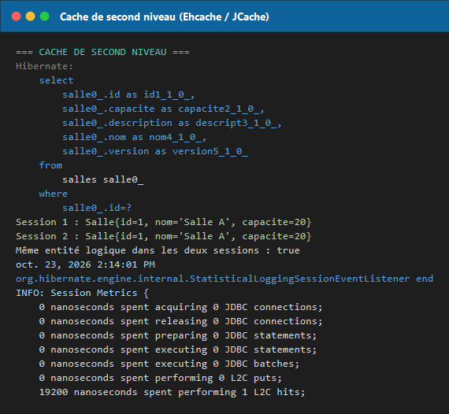
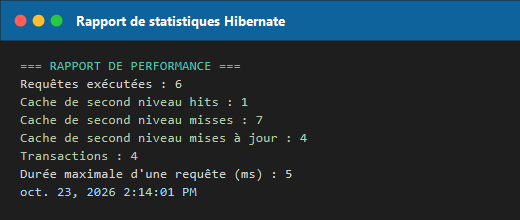

# TP (Capstone) — Finaliser l'application « Réservation de salles » avec JPA & Hibernate

Projet **JEE classique** (JPA 2.2 + Hibernate 5.4, sans Spring) finalisant l'application de
réservation de salles : gestion des entités, opérations CRUD transactionnelles, **cache de second
niveau Ehcache**, **script de migration SQL** exécuté en JDBC et **rapport de statistiques Hibernate**.

- **Dépôt :** <https://github.com/aithalibi/reservation-capstone>
- **Cours :** Hibernate & JPA — TP (Capstone), lab `151`
- **Type :** application console Maven (pas de serveur d'application requis, base H2 en mémoire)

---

## 1. Objectif du TP

Le capstone demande de partir d'un modèle de réservation de salles et de le **finaliser** :

| Exigence du sujet | Implémentation |
|---|---|
| Entités `Utilisateur`, `Salle`, `Reservation` | `com.example.model.*` (JPA + verrouillage optimiste) |
| Gestion des salles et des réservations | `ReservationService` (create / update / delete / rechercher / compter) |
| Requêtes JPQL **et** Criteria API | `rechercherParSalleEtDate` / `rechercherAvecCriteria` |
| Cache de second niveau **Ehcache** | `@Cacheable` + `@Cache(READ_WRITE)`, `JCacheRegionFactory`, `ehcache.xml` |
| Migration JDBC (script SQL) | `MigrationExecutor` + `db/migration/v2_0_add_description.sql` |
| Rapport de statistiques Hibernate | `PerformanceReport` via `org.hibernate.stat.Statistics` |
| Tests fonctionnels | `ReservationTest` — 3 tests JUnit 5 |

---

## 2. Résultats d'exécution (captures réelles)

Toutes les captures ci-dessous proviennent de l'exécution du projet ; le journal intégral est
conservé dans [`docs/execution.log`](docs/execution.log).

### 2.1 Compilation, tests et exécution

```bash
mvn -B clean test exec:java
```


`Tests run: 3, Failures: 0, Errors: 0, Skipped: 0` → **BUILD SUCCESS**.

### 2.2 Logs SQL générés par Hibernate

Hibernate crée le schéma (`hbm2ddl.auto=create-drop`) et journalise chaque ordre SQL
(`show_sql`, `format_sql`, `use_sql_comments`).


### 2.3 Migration de base de données + scénarios CRUD

Le script `v2_0_add_description.sql` est appliqué **en JDBC** après la création du schéma, puis les
trois scénarios (création, modification, suppression) sont exécutés. On observe les ordres
`insert`, `update ... where id=? and version=?` (verrouillage optimiste) et `delete`.


### 2.4 Cache de second niveau

La même entité `Salle` est chargée dans **deux sessions distinctes**. La seconde lecture ne génère
**aucun SELECT** : `1 L2C hit`, `0 miss`.



> **Point clé :** le cache de premier niveau (l'`EntityManager`) masque toujours le cache L2 dans une
> même session. Il faut donc **deux `EntityManager`** pour observer un hit, ce que fait
> `MainApp.demonstrationCacheSecondNiveau()`.

### 2.5 Rapport de statistiques Hibernate



---

## 3. Structure du projet

```
reservation-capstone/
├── pom.xml
├── docs/
│   ├── execution.log                     # journal complet d'exécution
│   └── screenshots/                      # captures référencées ci-dessus
└── src/
    ├── main/
    │   ├── java/com/example/
    │   │   ├── MainApp.java              # point d'entrée : les 6 étapes du TP
    │   │   ├── model/
    │   │   │   ├── Utilisateur.java      # @Entity @Cacheable @Cache(READ_WRITE) @Version
    │   │   │   ├── Salle.java            # id, nom, capacite, description, version
    │   │   │   └── Reservation.java      # salle, utilisateur, dateDebut, dateFin
    │   │   ├── service/
    │   │   │   └── ReservationService.java
    │   │   └── util/
    │   │       ├── DataInitializer.java  # 3 utilisateurs, 3 salles, 3 réservations
    │   │       ├── MigrationExecutor.java# exécution JDBC du script SQL
    │   │       └── PerformanceReport.java# rapport Statistics
    │   └── resources/
    │       ├── META-INF/persistence.xml  # unité ReservationPU
    │       ├── ehcache.xml               # configuration Ehcache 3 (JSR-107)
    │       └── db/migration/v2_0_add_description.sql
    └── test/java/com/example/test/
        └── ReservationTest.java          # 3 tests JUnit 5
```

---

## 4. Modèle de données

| Entité | Table | Champs |
|---|---|---|
| `Utilisateur` | `utilisateurs` | `id`, `nom`, `email` (unique), `version` |
| `Salle` | `salles` | `id`, `nom` (unique), `capacite`, `description`, `version` |
| `Reservation` | `reservations` | `id`, `salle_id`, `utilisateur_id`, `dateDebut`, `dateFin`, `version` |

Chaque entité porte :

```java
@Entity
@Table(name = "salles")
@Cacheable
@Cache(usage = CacheConcurrencyStrategy.READ_WRITE)
public class Salle {

    @Id @GeneratedValue(strategy = GenerationType.IDENTITY)
    private Long id;

    @Version
    private int version;
    // ...
}
```

- `@Cacheable` + `@Cache(READ_WRITE)` → l'entité est stockée dans le cache L2 avec une stratégie
  lecture/écriture, cohérente avec `@Version`.
- `@Version` → **verrouillage optimiste** : Hibernate ajoute `and version=?` dans les `UPDATE`/`DELETE`.

---

## 5. Migration de base de données (JDBC)

`db/migration/v2_0_add_description.sql` :

```sql
-- Migration version 2.0 : ajout de la colonne "description" à la table "salles"
ALTER TABLE salles ADD COLUMN IF NOT EXISTS description VARCHAR(255);

-- Ajout d'un index sur la colonne "email" de la table "utilisateurs"
CREATE UNIQUE INDEX IF NOT EXISTS idx_utilisateur_email ON utilisateurs(email);
```

`MigrationExecutor` lit le script depuis le classpath et l'exécute **via l'API JDBC**
(`DriverManager`, `Statement`), indépendamment de JPA — c'est la démonstration d'une migration
« à la main », sans outil type Flyway.

> Le script est écrit de façon **idempotente** (`IF NOT EXISTS`) : Hibernate a déjà créé le schéma
> (`create-drop`) et la colonne `description` existe donc déjà. Sans cette précaution H2 lève
> `Duplicate column name "DESCRIPTION"`.

---

## 6. Cache de second niveau

`persistence.xml` :

```xml
<property name="hibernate.cache.use_second_level_cache" value="true"/>
<property name="hibernate.cache.region.factory_class"
          value="org.hibernate.cache.jcache.JCacheRegionFactory"/>
<property name="hibernate.javax.cache.provider" value="org.ehcache.jsr107.EhcacheCachingProvider"/>
<property name="hibernate.javax.cache.uri" value="ehcache.xml"/>
<property name="hibernate.cache.use_query_cache" value="true"/>
```

`ehcache.xml` déclare une région par entité (TTL 60 min, 1 000 entrées) et un `cache-template`
par défaut qui laisse Hibernate créer ses régions internes (`timestamps`, cache de requêtes).

Les requêtes JPQL/Criteria sont marquées *cacheables* :

```java
query.setHint("org.hibernate.cacheable", Boolean.TRUE);
```

**Mesure observée :**

| Session | SELECT émis | L2C hits | L2C misses |
|---|---|---|---|
| 1 — `em.find(Salle.class, 1L)` | 1 | 0 | 1 |
| 2 — nouvel `EntityManager` | **0** | **1** | 0 |

---

## 7. Rapport de statistiques Hibernate

Activé par `hibernate.generate_statistics=true`, exploité dans `PerformanceReport` :

```java
Statistics stats = em.unwrap(Session.class).getSessionFactory().getStatistics();
System.out.println("Requêtes exécutées : " + stats.getQueryExecutionCount());
System.out.println("Cache de second niveau hits : " + stats.getSecondLevelCacheHitCount());
System.out.println("Cache de second niveau misses : " + stats.getSecondLevelCacheMissCount());
System.out.println("Cache de second niveau mises à jour : " + stats.getSecondLevelCachePutCount());
System.out.println("Transactions : " + stats.getTransactionCount());
System.out.println("Durée maximale d'une requête (ms) : " + stats.getQueryExecutionMaxTime());
```

Résultat de l'exécution enregistrée :

```
Requêtes exécutées : 6
Cache de second niveau hits : 1
Cache de second niveau misses : 7
Cache de second niveau mises à jour : 4
Transactions : 4
Durée maximale d'une requête (ms) : 5
```

---

## 8. Tests fonctionnels

`ReservationTest` (JUnit 5) — cycle de vie : `@BeforeAll` (EntityManagerFactory), `@BeforeEach`,
`@AfterEach`, `@AfterAll`.

| Test | Vérifie |
|---|---|
| `testCreateReservation` | persistance d'une réservation et relecture par `find` |
| `testModifierReservation` | mise à jour de la date de fin et incrément de `version` |
| `testSupprimerReservation` | suppression puis `find` → `null` |

```bash
mvn -B test
```

```
[INFO] Tests run: 3, Failures: 0, Errors: 0, Skipped: 0
```

---

## 9. Compilation et exécution

**Prérequis :** JDK 8+ et Maven (le projet compile en `source/target 1.8`).

```bash
# 1. Compiler et lancer les tests
mvn clean test

# 2. Exécuter l'application (les 6 étapes du TP s'enchaînent)
mvn exec:java

# ou en une seule commande
mvn clean test exec:java
```

Le programme affiche successivement :

```
=== MIGRATION DE BASE DE DONNEES ===
=== SCENARIOS DE TEST ===
=== REQUETES JPQL ET CRITERIA API ===
=== CACHE DE SECOND NIVEAU ===
=== RAPPORT DE PERFORMANCE ===
```

> La classe principale (`com.example.MainApp`) est fixée dans la configuration du
> `exec-maven-plugin` du `pom.xml` ; un `-Dexec.mainClass=...` passé en ligne de commande serait
> ignoré tant que `<configuration><mainClass>` est présent.

---

## 10. Dépendances

| Dépendance | Version | Rôle |
|---|---|---|
| `javax.persistence:javax.persistence-api` | 2.2 | API JPA |
| `org.hibernate:hibernate-core` | 5.4.32.Final | Implémentation JPA |
| `org.hibernate:hibernate-ehcache` | 5.4.32.Final | Intégration Ehcache 2 |
| `org.hibernate:hibernate-jcache` | 5.4.32.Final | Fournit `JCacheRegionFactory` (JSR-107) |
| `org.ehcache:ehcache` | 3.8.1 | Cache de second niveau |
| `com.h2database:h2` | 1.4.200 | Base en mémoire (`runtime`) |
| `org.junit.jupiter:junit-jupiter` | 5.9.3 | Tests (`test`) |

---

## 11. Écarts assumés par rapport à l'énoncé

Le code du support n'était pas exécutable tel quel ; voici les corrections apportées, toutes
expliquées en commentaire dans les sources :

| Énoncé | Réalisation | Raison |
|---|---|---|
| `hibernate-ehcache` seul | ajout de **`hibernate-jcache`** | `org.hibernate.cache.jcache.JCacheRegionFactory` est introuvable sans lui |
| `Statistics.getQueryExecutionTotalTime()` | `getQueryExecutionMaxTime()` | la méthode n'existe pas dans l'API `Statistics` de Hibernate 5.4 |
| Script SQL brut | `ADD COLUMN IF NOT EXISTS`, `CREATE UNIQUE INDEX IF NOT EXISTS` | Hibernate a déjà créé le schéma → sinon `Duplicate column name "DESCRIPTION"` |
| Dates de test quelconques | `.withNano(0)` dans les tests | H2 tronque les nanosecondes, ce qui faisait échouer l'assertion |
| `LocalDateTime.now()` pour la requête mise en cache | **une date de référence unique** | des paramètres différents à chaque appel empêchent tout hit du cache de requêtes |
| Démonstration du cache L2 dans une seule session | **deux `EntityManager`** | le cache de 1er niveau masque le L2 dans une même session |

---

## 12. Ce que démontre ce TP

1. Une application JPA complète **sans conteneur** (`Persistence.createEntityManagerFactory`).
2. Le **verrouillage optimiste** via `@Version` (SQL `... and version=?` visible dans les logs).
3. Le **cache de second niveau** partagé entre sessions, avec un gain mesurable (0 SELECT au 2ᵉ accès).
4. Une **migration de schéma** exécutée en JDBC pur, idempotente.
5. Un **rapport de performance** fondé sur les statistiques natives d'Hibernate.
